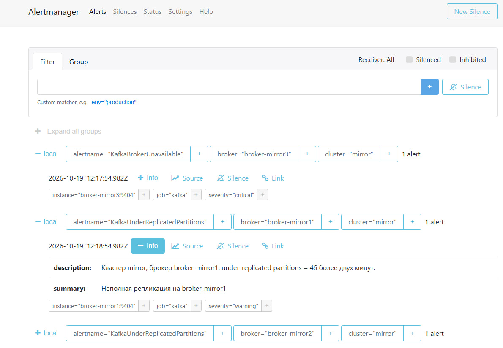

# Аналитическая платформа маркетплейса на Apache Kafka

Финальный проект аналитической платформы маркетплейса по курсу Apache Kafka.

Система принимает товары магазинов, фильтрует запрещённые товары, сохраняет разрешённые данные в PostgreSQL, собирает поисковые интересы клиентов и формирует рекомендации.

Для передачи событий используется Apache Kafka. Дублирование данных между двумя Kafka-кластерами выполняется через MirrorMaker 2. Результаты рекомендаций доступны через ksqlDB. Мониторинг реализован на Prometheus, JMX Exporter, Grafana и Alertmanager.

## 1. Архитектура

Платформа состоит из двух Kafka-кластеров, Python-приложений для отправки и обработки событий, PostgreSQL, ksqlDB и системы мониторинга. Центральный компонент — **Kafka**, через которую сервисы обмениваются данными.

### Основной Kafka-кластер

Основной кластер включает три брокера: `broker1`, `broker2`, `broker3`. Он принимает товары магазинов, поисковые события клиентов, запросы рекомендаций и результаты обработки.

Подключения к основному кластеру защищены TLS с обязательным клиентским сертификатом. Для бизнес-топиков используются три партиции, фактор репликации `3` и `min.insync.replicas=2`.

### Приём и фильтрация товаров

Приложение `shop_api.py` эмулирует SHOP API: читает товары из JSON-файла и отправляет их в топик `shop.products.raw`.

Faust-приложение `stream_processor.py` читает этот топик и проверяет `product_id` каждого товара по списку запрещённых. Запрещённые товары не передаются дальше, разрешённые публикуются в `shop.products.valid`.

Список запретов хранится в `data/banned_products.json`. Управление выполняется через `banned_products_cli.py`: можно посмотреть список, добавить запрет или снять его. Изменения применяются к следующим обрабатываемым сообщениям без перезапуска фильтра.

### Хранение и поиск товаров

Приложение `products_sink.py` читает только отфильтрованные сообщения из `shop.products.valid` и сохраняет их в таблицу `products` базы PostgreSQL.

Исходный JSON товара хранится в поле `document` типа `JSONB`. Сочетание `store_id` и `product_id` служит ключом записи. Повторное поступление товара обновляет существующую строку, а не создаёт дубликат.

Приложение `client_api.py` предоставляет интерфейс командной строки. При поиске оно отправляет событие в `client.search.requests`, сохраняет запрос в таблицу `client_requests`, выполняет поиск по имени товара в PostgreSQL и показывает результаты пользователю.

### Формирование рекомендаций

Faust-приложение `recommendation_processor.py` получает разрешённые товары из `shop.products.valid` и формирует каталог.

Из топика `client.search.requests` оно получает поисковые события. По категориям найденных товаров обработчик обновляет интересы соответствующего `client_id`.

Команда `recommend` в CLIENT API отправляет событие в `client.recommendation.requests`. Обработчик выбирает до пяти товаров из интересующих пользователя категорий и записывает результат в отдельный топик `client.recommendations`.

Ключ результата — `client_id`. В сообщении также сохраняется `request_id`, позволяющий сопоставить рекомендации с исходным запросом.

### Выдача рекомендаций через ksqlDB

ksqlDB читает `client.recommendations` и поддерживает материализованную таблицу `USER_RECOMMENDATIONS` с последним обработанным результатом для каждого пользователя.

Для получения рекомендаций выполняется SQL pull query через HTTP API ksqlDB с условием по идентификатору пользователя.

Для топика `client.recommendations` используется `cleanup.policy=compact`: сообщения одного пользователя имеют одинаковый ключ, что позволяет сохранять последнее состояние рекомендаций при компактации.

### Дублирование данных во второй кластер

Зеркальный Kafka-кластер включает три брокера: `broker-mirror1`, `broker-mirror2`, `broker-mirror3`.

MirrorMaker 2 переносит в него сообщения из настроенных топиков основного кластера:

- `shop.products.raw`;
- `client.search.requests`;
- `client.recommendation.requests`.

В зеркальном кластере эти топики получают префикс `source.`, например `source.shop.products.raw`. Служебные топики MirrorMaker используются для координации и хранения информации о переносе данных.

### Мониторинг и алерты

К каждому брокеру обоих кластеров подключён JMX Exporter, который предоставляет метрики Kafka и JVM.

Prometheus регулярно собирает метрики и вычисляет правила алертов. Grafana использует Prometheus как источник данных и показывает доступность брокеров, состояние репликации, количество партиций и скорость передачи сообщений.

При недоступности endpoint брокера, неполной репликации или появлении недоступных партиций Prometheus передаёт алерты в Alertmanager. В текущем учебном стенде они отображаются в веб-интерфейсе Alertmanager; внешние каналы доставки уведомлений не настроены.

### Потоки данных

1. `shop_api.py` читает JSON-файл и отправляет товары в `shop.products.raw`.
2. `stream_processor.py` проверяет `product_id` по списку запретов.
3. Разрешённые товары попадают в `shop.products.valid`.
4. `products_sink.py` сохраняет разрешённые товары в PostgreSQL.
5. `client_api.py` выполняет поиск по PostgreSQL и отправляет поисковые события в Kafka.
6. `recommendation_processor.py` собирает каталог и категории интересов клиентов.
7. По запросу рекомендации результат записывается в `client.recommendations`.
8. ksqlDB поддерживает таблицу последних рекомендаций по пользователю.
9. MirrorMaker 2 дублирует настроенные исходные топики во второй кластер.

## 1. Используемые технологии

| Компонент | Назначение |
|---|---|
| Python | CLI-приложения и обработчики |
| kafka-python | Отправка и чтение сообщений Kafka |
| faust-streaming | Потоковая фильтрация и рекомендации |
| Apache Kafka / Confluent Platform 7.5.0 | Транспорт событий |
| ZooKeeper | Координация Kafka-кластеров |
| MirrorMaker 2 | Дублирование данных между кластерами |
| PostgreSQL 16 | Каталог товаров и история клиентских запросов |
| psycopg2 | Работа Python с PostgreSQL |
| ksqlDB | Материализованное представление рекомендаций |
| Kafka UI | Просмотр основного Kafka-кластера |
| JMX Exporter | Экспорт метрик JVM и Kafka |
| Prometheus | Сбор метрик и вычисление правил алертов |
| Grafana | Дашборд мониторинга |
| Alertmanager | Приём и отображение алертов |
| Docker Compose | Запуск инфраструктуры |

## 2. Требования к окружению

Инструкция рассчитана на Linux с Bash. 

Потребуются:

- Git;
- Docker Engine и Docker Compose v2;
- Python 3.11 с модулем `venv`;
- curl;
- OpenSSL;
- доступ к Docker Hub и репозиторию Python-пакетов.

Практический ориентир для запуска полного стенда:

- 8 логических CPU;
- 16–24 ГБ оперативной памяти;
- не менее 20 ГБ свободного дискового пространства.

Все компоненты запускаются на одном компьютере. Имена контейнеров фиксированы, поэтому параллельный запуск нескольких копий проекта на одном Docker-хосте не предусмотрен.

### Установка системных утилит

Для Ubuntu/Debian:

```bash
sudo apt-get update

sudo apt-get install -y \
  git \
  curl \
  openssl \
  ca-certificates \
  python3 \
  python3-venv \
  python3-pip
```

Установите Docker Engine и Docker Compose v2 для своей ОС по официальной инструкции Docker.

Проверьте окружение:

```bash
git --version
python3 --version
docker --version
docker compose version
docker info
```

Все дальнейшие команды Docker выполняются пользователем с доступом к Docker daemon.

## 3. Клонирование репозитория

```bash
git clone https://github.com/beezzlot/yandex-kafka-final.git

cd yandex-kafka-final
```

Все последующие команды, если явно не указано другое, выполняются из корня репозитория.

## 4. Настройка окружения

Создайте рабочий файл настроек:

```bash
cp .env.example .env
```

Откройте `.env` и задайте пароль Grafana:

```env
GRAFANA_ADMIN_PASSWORD=укажите_свой_пароль
```

Основные параметры:

```env
KAFKA_BOOTSTRAP_SERVERS=localhost:9094
KAFKA_SECURITY_PROTOCOL=SSL
KAFKA_SSL_CAFILE=ssl/ca.crt
KAFKA_SSL_CERTFILE=ssl/app.crt
KAFKA_SSL_KEYFILE=ssl/app.key

SHOP_PRODUCTS_TOPIC=shop.products.raw
SHOP_VALID_PRODUCTS_TOPIC=shop.products.valid

CLIENT_SEARCH_TOPIC=client.search.requests
CLIENT_RECOMMENDATION_TOPIC=client.recommendation.requests

PRODUCTS_FILE=data/products.json
BANNED_PRODUCTS_FILE=data/banned_products.json
PRODUCTS_SINK_GROUP=postgres-products-sink

POSTGRES_HOST=localhost
POSTGRES_PORT=5432
POSTGRES_DB=marketplace
POSTGRES_USER=marketplace
POSTGRES_PASSWORD=marketplace
```

Python-приложения запускаются на Docker-хосте. Поэтому для них используются внешние адреса Kafka `localhost:9094`, `localhost:9095` и `localhost:9083`.

Начального подключения к `localhost:9094` достаточно для получения метаданных остальных брокеров.

Внутри Docker используются адреса `broker1:9092`, `broker2:9092`, `broker3:9092`.

## 5. Сертификаты учебного стенда

В текущем репозитории уже находятся сертификаты и хранилища, необходимые для запуска:

```text
ssl/
├── ca.crt
├── ca.key
├── app.crt
├── app.key
├── app.keystore.jks
├── app.truststore.jks
├── broker1/
├── broker2/
└── broker3/
```

Проверьте наличие файлов:

```bash
test -s ssl/ca.crt
test -s ssl/app.crt
test -s ssl/app.key

for broker in broker1 broker2 broker3; do
  test -s "ssl/$broker/$broker.keystore.jks" || exit 1
  test -s "ssl/$broker/$broker.truststore.jks" || exit 1
done
```

Проверьте сертификат клиента:

```bash
openssl verify -CAfile ssl/ca.crt ssl/app.crt
```

Ожидается:

```text
ssl/app.crt: OK
```

Посмотреть срок действия:

```bash
openssl x509 -in ssl/app.crt -noout -dates
```

Сертификаты из репозитория предназначены исключительно для изолированного учебного стенда. Их закрытые ключи публичны и не должны использоваться для защиты реальных данных.

Если сертификаты просрочены, их необходимо перевыпустить до запуска.

Основной кластер использует TLS с обязательным клиентским сертификатом. Зеркальный кластер в текущей версии использует PLAINTEXT внутри Docker-сети.

## 6. Подготовка JMX Exporter

Проверьте наличие Java agent:

```bash
test -s monitoring/jmx/jmx_prometheus_javaagent.jar
test -s monitoring/jmx/kafka.yml
```

Если JAR отсутствует, скачайте его:

```bash
mkdir -p monitoring/jmx

curl --fail --location --retry 3 \
  https://repo.maven.apache.org/maven2/io/prometheus/jmx/jmx_prometheus_javaagent/1.0.1/jmx_prometheus_javaagent-1.0.1.jar \
  --output monitoring/jmx/jmx_prometheus_javaagent.jar
```

Java agent подключается через `KAFKA_OPTS` каждого брокера. Метрики доступны внутри Docker-сети на порту `9404`.

## 7. Запуск основного Kafka-кластера и PostgreSQL

Создайте внешнюю сеть:

```bash
docker network inspect kafka-internal >/dev/null 2>&1 \
  || docker network create kafka-internal
```

Запуск основного кластера Kafka 

```bash
docker compose -f docker-compose-kafka.yml up -d 
```

Проверьте состояние:

```bash
docker compose -f docker-compose-kafka.yml ps
```

## 8. Инициализация топиков

В docker-compose-kafka.yml существует контейнер init-topics, который автоматически создает топики и партиции согласно заданию:

```bash
docker compose -f docker-compose-kafka.yml logs init-topics
```

При ошибке дождитесь готовности всех трёх брокеров и повторите команду.

Скрипт `scripts/init-kafka-topics.sh` создаёт:

| Топик | Партиции | RF | Назначение |
|---|---:|---:|---|
| `shop.products.raw` | 3 | 3 | Товары магазинов |
| `shop.products.valid` | 3 | 3 | Разрешённые товары |
| `client.search.requests` | 3 | 3 | Поисковые события |
| `client.recommendation.requests` | 3 | 3 | Запросы рекомендаций |
| `client.recommendations` | 3 | 3 | Результаты рекомендаций |

Для бизнес-топиков задаётся `min.insync.replicas=2`.

Для `client.recommendations` дополнительно устанавливается:

```properties
cleanup.policy=compact
```

Ключ сообщения рекомендаций — `client_id`.

Проверьте топики:

```bash
docker exec broker1 kafka-topics \
  --bootstrap-server broker1:9092 \
  --command-config /tmp/admin.properties \
  --list
```

Проверьте репликацию:

```bash
docker exec broker1 kafka-topics \
  --bootstrap-server broker1:9092 \
  --command-config /tmp/admin.properties \
  --describe \
  --topic shop.products.raw
```

Ожидаются:

- `PartitionCount: 3`;
- `ReplicationFactor: 3`;
- три ISR для каждой партиции после синхронизации;
- `min.insync.replicas=2` в конфигурации топика.

Проверка конфигурации:

```bash
docker exec broker1 kafka-configs \
  --bootstrap-server broker1:9092 \
  --command-config /tmp/admin.properties \
  --entity-type topics \
  --entity-name shop.products.raw \
  --describe
```

Или всё тоже самое можно выяснить через kafka-ui на порту 8080. 

## 9. Проверка TLS и ACL

Проверьте TLS-подключение с клиентским сертификатом:

```bash
openssl s_client \
  -connect localhost:9094 \
  -servername localhost \
  -CAfile ssl/ca.crt \
  -cert ssl/app.crt \
  -key ssl/app.key \
  -verify_hostname localhost \
  -verify_return_error \
  </dev/null
```

Ожидается успешная проверка цепочки сертификатов.

Посмотрите зарегистрированные ACL:

```bash
docker exec broker1 kafka-acls \
  --bootstrap-server broker1:9092 \
  --command-config /tmp/admin.properties \
  --list
```

В текущем учебном стенде `User:CN=app` входит в `KAFKA_SUPER_USERS`. Поэтому просмотр ACL подтверждает наличие правил, но не доказывает ограничение прав приложений: сертификат `app` обходит ACL.

## 10. Запуск зеркального кластера и MirrorMaker 2

```bash
docker compose -f docker-compose-kafka-mirror.yml up -d
```

Проверьте доступность:

```bash
docker exec broker-mirror1 kafka-topics \
  --bootstrap-server broker-mirror1:9092 \
  --list
```

Проверьте логи:

```bash
docker logs --tail 100 mirror-maker
```

В текущем `config/mm2.properties` зеркалируются:

```text
shop.products.raw
client.search.requests
client.recommendation.requests
```

На целевом кластере они получают префикс `source.`:

```text
source.shop.products.raw
source.client.search.requests
source.client.recommendation.requests
```

Посмотрите список:

```bash
docker exec broker-mirror1 kafka-topics \
  --bootstrap-server broker-mirror1:9092 \
  --list
```

Первичное обнаружение топиков выполняется не мгновенно. При необходимости повторите проверку через 30–60 секунд.

Дополнительные топики `heartbeats`, `mm2-*` и `*.checkpoints.internal` относятся к служебным данным MirrorMaker.

## 11. Подготовка Python

```bash
python3 -m venv .venv

source .venv/bin/activate

python3 -m pip install --upgrade pip

python3 -m pip install -r requirements.txt

```

## 12. Запуск обработчиков

Обработчики работают постоянно. Запускайте их в трёх отдельных терминалах.

В каждом терминале сначала перейдите в корень клонированного репозитория и активируйте окружение:

```bash
source .venv/bin/activate
```

### Терминал 1: фильтрация товаров

```bash
python3 stream_processor.py worker -l info
```

Faust использует порт `6066`.

Дождитесь:

```text
Worker ready
```

или:

```text
Ready
```

### Терминал 2: рекомендации

```bash
python3 recommendation_processor.py worker -l info
```

Faust использует порт `6067`.

Приложение рассчитано на один recommendation worker. Это важно для текущего способа чтения локального каталога Faust Table.

### Терминал 3: запись товаров в PostgreSQL

```bash
python3 products_sink.py
```

Consumer использует группу:

```text
postgres-products-sink
```

Сохранение выполняется в таблицу `products`:

- ключ записи: `(store_id, product_id)`;
- исходный документ: `JSONB`;
- повторное сообщение обновляет запись через `ON CONFLICT`;
- Kafka offset подтверждается после успешной транзакции PostgreSQL.

## 13. Загрузка товаров

В отдельном терминале с активированным окружением:

```bash
python3 shop_api.py
```

По умолчанию используется:

```text
data/products.json
```

Можно указать другой файл:

```bash
python3 shop_api.py data/products.json
```

Ожидаемые сообщения фильтра:

```text
allowed: 12345
allowed: 12346
```

Ожидаемые сообщения обработчика рекомендаций:

```text
catalog updated: 12345
catalog updated: 12346
```

Ожидаемые сообщения PostgreSQL sink:

```text
saved: store=store_001 product=12345 ...
```

## 14. Проверка сохранения в PostgreSQL

```bash
docker exec postgres psql \
  -U marketplace \
  -d marketplace \
  -c "
    SELECT
        store_id,
        product_id,
        document->>'name' AS name,
        document->>'category' AS category
    FROM products
    ORDER BY store_id, product_id;
  "
```

Повторная загрузка того же каталога не должна увеличивать число строк:

```bash
docker exec postgres psql \
  -U marketplace \
  -d marketplace \
  -c "SELECT COUNT(*) FROM products;"
```

```bash
python3 shop_api.py
```

Дождитесь обработки и повторите `COUNT(*)`.

## 15. Проверка фильтра запрещённых товаров

Просмотр списка:

```bash
python3 banned_products_cli.py list
```

Добавление запрета:

```bash
python3 banned_products_cli.py add 99998 \
  --reason "Проверка фильтрации"
```

Создайте тестовый товар с новым ID:

```bash
python3 - <<'PY'
import json
from pathlib import Path

products = json.loads(
    Path("data/products.json").read_text(encoding="utf-8")
)

product = products
product["product_id"] = "99998"
product["name"] = "Тестовый запрещённый товар"
product["sku"] = "TEST-99998"

Path("data/banned_storage_test.json").write_text(
    json.dumps([product], ensure_ascii=False, indent=2) + "\n",
    encoding="utf-8",
)
PY
```

Отправьте товар:

```bash
python3 shop_api.py data/banned_storage_test.json
```

В фильтре ожидается:

```text
blocked: 99998
```

Проверьте отсутствие товара в БД:

```bash
docker exec postgres psql \
  -U marketplace \
  -d marketplace \
  -c "SELECT COUNT(*) FROM products WHERE product_id='99998';"
```

При первом запуске теста ожидается `0`.

Снять запрет:

```bash
python3 banned_products_cli.py remove 99998
```

Повторно отправьте товар:

```bash
python3 shop_api.py data/banned_storage_test.json
```

Теперь ожидается `allowed: 99998`, а после обработки sink товар появится в PostgreSQL.

Изменение списка подхватывается без перезапуска фильтра.

Повторное добавление запрета не удаляет уже сохранённый товар и не отзывает ранее опубликованные рекомендации.

## 16. Проверка зеркалирования

После отправки каталога прочитайте сообщение из зеркального кластера:

```bash
docker exec broker-mirror1 kafka-console-consumer \
  --bootstrap-server broker-mirror1:9092 \
  --topic source.shop.products.raw \
  --from-beginning \
  --max-messages 1 \
  --timeout-ms 15000
```

Ожидается JSON товара.

Проверьте реплики зеркального топика:

```bash
docker exec broker-mirror1 kafka-topics \
  --bootstrap-server broker-mirror1:9092 \
  --describe \
  --topic source.shop.products.raw
```

Проверяйте фактические `ReplicationFactor`, ISR и настройки топика, а не только число брокеров в compose.

## 17. Поиск товаров через CLIENT API

```bash
python3 client_api.py
```

Команды:

```text
search <client_id> <название товара>
recommend <client_id>
help
exit
```

Примеры:

```text
search client_001 часы
search client_002 Кроссовки
search client_003 книга
```

Поиск:

1. Отправляет событие в Kafka.
2. Сохраняет запрос в `client_requests`.
3. Ищет товар по части имени в PostgreSQL.
4. Показывает результаты в терминале.

Проверьте историю:

```bash
docker exec postgres psql \
  -U marketplace \
  -d marketplace \
  -c "
    SELECT client_id, request_type, query, created_at
    FROM client_requests
    ORDER BY created_at DESC
    LIMIT 10;
  "
```

## 18. Проверка рекомендаций

В CLIENT API:

```text
search client_001 часы
```

Дождитесь в recommendation worker:

```text
interests updated: client_001 -> ['Электроника']
```

Затем:

```text
recommend client_001
```

Ожидается:

```text
recommendations sent: client_001 -> 3
```

Алгоритм:

1. Находит товары по поисковому тексту.
2. Запоминает их категории в интересах пользователя.
3. Выбирает до пяти товаров из интересующих категорий.
4. Публикует результат в `client.recommendations`.

Это детерминированная категорийная логика.

Поиск и рекомендации используют разные топики, поэтому между ними нет общей гарантии порядка. Перед запросом рекомендаций дождитесь обработки поискового события.

Прочитать результаты непосредственно из Kafka:

```bash
docker exec broker1 kafka-console-consumer \
  --bootstrap-server broker1:9092 \
  --consumer.config /tmp/admin.properties \
  --topic client.recommendations \
  --from-beginning \
  --timeout-ms 10000
```

## 19. Первоначальная настройка ksqlDB

Запустите сервер:

```bash
dc up -d ksqldb-server
```

Проверьте готовность:

```bash
curl --fail http://localhost:8088/info
```

Следующие две команды создания объектов выполняются один раз на чистом стенде.

### Создание потока

```bash
curl --fail-with-body -sS \
  -X POST http://localhost:8088/ksql \
  -H 'Content-Type: application/vnd.ksql.v1+json; charset=utf-8' \
  --data-binary @- <<'EOF'
{
  "ksql": "CREATE STREAM RECOMMENDATION_EVENTS (USER_KEY VARCHAR KEY, REQUEST_ID VARCHAR, CLIENT_ID VARCHAR, RECOMMENDATIONS ARRAY<STRUCT<PRODUCT_ID VARCHAR, NAME VARCHAR, CATEGORY VARCHAR, PRICE STRUCT<AMOUNT DOUBLE, CURRENCY VARCHAR>>>) WITH (KAFKA_TOPIC='client.recommendations', KEY_FORMAT='KAFKA', VALUE_FORMAT='JSON');",
  "streamsProperties": {}
}
EOF
```

### Создание материализованной таблицы

```bash
curl --fail-with-body -sS \
  -X POST http://localhost:8088/ksql \
  -H 'Content-Type: application/vnd.ksql.v1+json; charset=utf-8' \
  --data-binary @- <<'EOF'
{
  "ksql": "CREATE TABLE USER_RECOMMENDATIONS WITH (KAFKA_TOPIC='client.recommendations.latest', KEY_FORMAT='KAFKA', VALUE_FORMAT='JSON', PARTITIONS=3, REPLICAS=3) AS SELECT USER_KEY, LATEST_BY_OFFSET(REQUEST_ID) AS REQUEST_ID, LATEST_BY_OFFSET(CLIENT_ID) AS CLIENT_ID, LATEST_BY_OFFSET(RECOMMENDATIONS) AS RECOMMENDATIONS FROM RECOMMENDATION_EVENTS GROUP BY USER_KEY EMIT CHANGES;",
  "streamsProperties": {
    "auto.offset.reset": "earliest"
  }
}
EOF
```

После успешного создания таблицы:

```bash
docker exec broker1 kafka-configs \
  --bootstrap-server broker1:9092 \
  --command-config /tmp/admin.properties \
  --entity-type topics \
  --entity-name client.recommendations.latest \
  --alter \
  --add-config cleanup.policy=compact,min.insync.replicas=2
```

### Получение рекомендаций

```bash
curl --fail-with-body -sS \
  -X POST http://localhost:8088/query \
  -H 'Content-Type: application/vnd.ksql.v1+json; charset=utf-8' \
  --data-binary @- <<'EOF'
{
  "ksql": "SELECT USER_KEY, REQUEST_ID, RECOMMENDATIONS FROM USER_RECOMMENDATIONS WHERE USER_KEY='client_001';",
  "streamsProperties": {}
}
EOF
```

Ожидается последний обработанный результат для `client_001`.

Поле `REQUEST_ID` позволяет сопоставить результат с запросом CLIENT API.

Созданные объекты ksqlDB сохраняются в Kafka и восстанавливаются после перезапуска при сохранении данных и `KSQL_KSQL_SERVICE_ID=marketplace_`.

Повторять `CREATE` после каждого рестарта не нужно.

## 20. Запуск мониторинга

Запустите:

```bash
docker compose -f docker-compose-monitoring.py  prometheus grafana alertmanager
```

### Prometheus

```text
http://localhost:9090/targets
```

Должно быть шесть Kafka targets со статусом `UP`.

Проверка через API:

```bash
curl -sS -G http://localhost:9090/api/v1/query \
  --data-urlencode 'query=up{job="kafka"}' \
  | python3 -m json.tool
```

Проверка Kafka-метрик:

```bash
curl -sS -G http://localhost:9090/api/v1/query \
  --data-urlencode 'query=kafka_under_replicated_partitions' \
  | python3 -m json.tool
```

Одного `up=1` недостаточно: он подтверждает доступность exporter, но не наличие всех нужных Kafka-метрик.

### Grafana

```text
http://localhost:3000
```

Логин:

```text
admin
```

Пароль берётся из `.env`.

Дашборд загружается автоматически:

```text
Dashboards → Kafka → Kafka — Source & Mirror
```

Прямая ссылка:

```text
http://localhost:3000/d/kafka-overview
```

Доступны фильтры по кластеру и брокеру.

Панели:

- доступность endpoints;
- under-replicated partitions;
- offline partitions;
- скорость входящих сообщений;
- входящий и исходящий трафик;
- количество реплик партиций;
- количество лидерских партиций;
- активный контроллер.

### Alertmanager

В текущем compose внешний порт — `9993`:

```text
http://localhost:9993
```

Внутри Docker Prometheus обращается к:

```text
alertmanager:9093
```

Внешняя доставка уведомлений не настроена. Алерты принимаются и отображаются в веб-интерфейсе Alertmanager.

Как на примере тут:



## 21. Проверка алертов и отказа брокера

Перед тестом убедитесь:

- доступны все шесть endpoints;
- under-replicated partitions равны нулю;
- offline partitions равны нулю.

Остановите один брокер зеркального кластера:

```bash
docker stop broker-mirror3
```

Не останавливайте второй брокер одновременно.

Примерно через 1–2 минуты проверьте:

```text
http://localhost:9090/alerts
```

И:

```text
http://localhost:9993
```

Ожидается алерт:

```text
KafkaBrokerUnavailable
cluster=mirror
broker=broker-mirror3
severity=critical
```

При сохранении неполной репликации также может сработать:

```text
KafkaUnderReplicatedPartitions
```

Проверка API Alertmanager:

```bash
curl -sS http://localhost:9993/api/v2/alerts \
  | python3 -m json.tool
```

Обязательно восстановите брокер:

```bash
docker start broker-mirror3
```

Дождитесь:

- шести доступных endpoints;
- восстановления ISR;
- нулевого числа under-replicated partitions;
- исчезновения соответствующих активных алертов.

## 22. Адреса сервисов

| Сервис | Адрес на Docker-хосте |
|---|---|
| Kafka external broker1 | `localhost:9094` |
| Kafka external broker2 | `localhost:9095` |
| Kafka external broker3 | `localhost:9083` |
| PostgreSQL | `localhost:5432` |
| Kafka UI | `http://localhost:8080` |
| ksqlDB | `http://localhost:8088` |
| Prometheus | `http://localhost:9090` |
| Grafana | `http://localhost:3000` |
| Alertmanager | `http://localhost:9993` |
